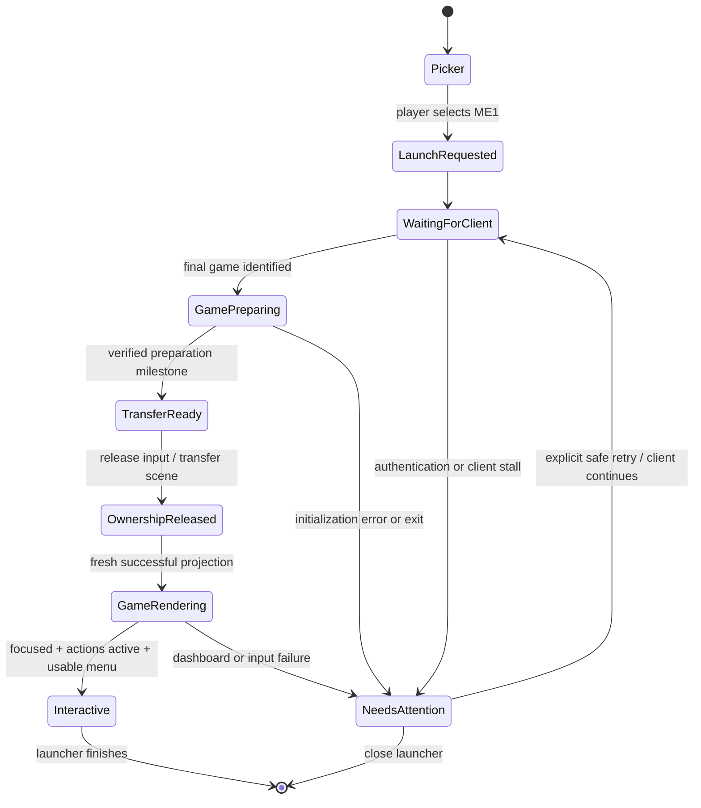

<!-- SPDX-License-Identifier: MIT -->
# Continuous VR startup for MEVR

**Archived 2026-11-13.** The custom launcher is shelved. The experiments and implementation steps below
describe the proposal at the time of review.

Planning and source review, 2026-11-08. This document proposes work; it does not claim the proposed handoff is implemented
or accepted. The existing standalone prototype is described in [its README](../tools/vr-launcher/README.md).

Research record: [64 — Continuous VR startup](../research/64-vr-launch-continuity.md), with the findings, evidence limits
and primary-source catalogue behind this plan.

## 1. The experience we are trying to deliver

For a returning player with a connected headset, working controllers, and a valid Steam/EA login, selecting **Launch in
VR** should keep them in a tracked VR presentation from our picker through loading, ME1's title screen, and gameplay.
It should require no desktop click, extra Resume action, or headset removal. Menus and logos can occupy a panel in a
tracked environment; they do not all need to become stereoscopic game geometry. Steam's Theater Screen should never
replace that presentation during a successful launch.

This target has four independent requirements:

1. Correct launch and authentication through the purchased game's normal client path.
2. Continuous tracked imagery with a deliberate owner while the next process initializes.
3. Correct scene identity and transfer of controller input.
4. A truthful, usable recovery path when a client, runtime, or game fails.

The user has deferred replacing Steam's ordinary Play behavior. Keep the standalone VR launch entry as the initial
scope. An optional Steam-entry integration can follow after the transition itself works. SteamVR/PS VR2 is the first
acceptance configuration; other runtime families are separate acceptance work, not silently redirected to SteamVR.

The ordinary returning-player path is the seamless target. A fresh EA login, account linking, client update, Windows
secure prompt, or deliberately opened SteamVR dashboard remains a distinct interruption. We can explain and recover
from those without promising that arbitrary third-party UI has become a native VR menu.

## 2. What we actually know

| Evidence | Established | Not established |
|---|---|---|
| RmlUi previews and pointer-event exercise | The existing game-menu renderer draws the picker and loading UI; event translation and duplicate-launch guard work offline. | PS VR2 controller aiming, panel comfort, or actual compositor appearance. |
| Null-driver launch on 2026-11-08 | The overlay initialized, Steam launched the expected LE1 process, that process became the compositor's scene owner and frame renderer, and the overlay released input. | A successful FOCUSED handoff or an observed press of Resume. |
| Same run | Dashboard telemetry stayed true; OpenXR reached VISIBLE (4), not FOCUSED (5). | That the dashboard is the only cause across real-headset configurations. |
| Theater-on/off comparison earlier that day | Both sampled runs rendered VR while remaining VISIBLE. | That Theater Screen can never appear, or that changing that setting fixes focus. |
| Current game code | `d3d_capture.cpp` calls `TryCreateSession` from the captured swapchain/device path. `xr_session.cpp` already supplies a black projection beneath quad-only SteamVR frames. | That moving initialization earlier is automatically useful; timings must identify the actual delay. |
| Original user report | The mod loaded, while the last retained XR startup evidence stopped before an instance-creation result. | That this user's problem is our dashboard/focus problem. Keep that diagnostic investigation separate. |

The launcher test used an existing private QA ASI to select SteamVR within the game process while the registered
OpenXR runtime was Virtual Desktop. That is a test arrangement, not validation of runtime selection in a public build.
The installed ASI and nine saved configuration/marker paths were restored and checked after the run. Local evidence
is under `scratch/vr-launcher-20261108-173502/` and `scratch/steamvr-theater-20261108-162741/`.

In the launcher run, the panel was shown at approximately 0.41 seconds, launch requested at 2.46, the game observed at
6.77, the game reported as frame renderer at 23.69, and launcher input released at 23.99. The bounded run ended at
55.45 seconds without confirmed focus. The existing game changed from its flat boot presentation to the 3D title
presentation a few seconds after its first tracked frame. These are baseline observations, not performance targets.

### Three different things that can look like theater mode

| Presentation | Owner | What to measure | What would address it |
|---|---|---|---|
| Steam's Theater Screen showing a desktop window | SteamVR shell | Compositor capture plus dashboard/theater observations and application identity | Correct launch classification/scene transition, or an explicitly documented runtime setting fallback |
| ME1's own boot movie/menu on a plane in VR | MEVR renderer | Submitted layer kinds and semantic boot/title state | A persistent tracked boot environment and deliberate menu transition |
| VR game behind an open dashboard with inactive controllers | Runtime focus policy | Dashboard state, XR session state, action synchronization and actual actions | Release our input, use a supported application handoff, respect system UI ownership |

Valve introduced the current Theater Screen for non-VR Steam launches separately from the older Desktop Game Theater
application. A desktop picture in a headset is therefore insufficient to identify the mechanism.
[Valve's SteamVR 2.1 announcement](https://store.steampowered.com/news/posts/?appids=250820&enddate=1700338492&feed=steam_community_announcements).

## 3. What other mods provide evidence for

### Titanfall 2 VR, CircuitLord

The [EA-owned launch follow-up](../research/64-vr-launch-continuity.md#ea-owned-launch-follow-up-titanfall-reports-and-source-trace)
adds issue #68's EA-install/shortcut report and a trace through the pinned Northstar engine launcher. Its shared store
launch path and game-specific bootstrap do not establish an equivalent direct-launch or focus solution for ME1.

The official installer documents a separate VR launch button, a `TF2VR` Northstar profile, and EA sign-in as a
prerequisite. Normal game launch remains unmodded. This supports using a dedicated entry and doing first-run client
setup ahead of the headset session; it does not establish uninterrupted VR from first click.
[Official README](https://github.com/CircuitLord/CircuitLordVRModInstaller/blob/3594ce8dabb13c7340a3bfe26af64341d53349f6/README.md).

The public installer source gives more precise evidence:

- Its EA setup opens the EA app visibly and asks the player to confirm they have signed in. The saved confirmation
  is a user acknowledgement, not proof of a currently valid authentication token.
- It installs Northstar's launcher under a VR-specific executable name and installs a mod-supplied probe, launch
  configuration, and crash monitor.
- Its Play path starts that monitor with the profile, VR launcher, and arguments from the package's launch configuration.
- It checks for conflicting DirectX proxy DLLs and records launch errors. Its UI also checks for elevated clients.
- Its child-process setup removes several inherited VR overrides before selecting the mod's OpenXR path.

Sources: [Titanfall installer](https://github.com/CircuitLord/CircuitLordVRModInstaller/blob/3594ce8dabb13c7340a3bfe26af64341d53349f6/src/Installer/Installers/Titanfall2Installer.cs),
[installer UI](https://github.com/CircuitLord/CircuitLordVRModInstaller/blob/3594ce8dabb13c7340a3bfe26af64341d53349f6/src/Installer/MainWindow.xaml.cs).

Transferable ideas are first-run authentication preparation, a controlled launch configuration, conflict detection,
and a monitor that survives startup. We should retain intentional user runtime overrides rather than copying its
environment policy wholesale. Its `GameLauncher.cs` and BepInEx startup watcher concern Big Walk and must not be
mistaken for Titanfall's launch implementation.

The installer license explicitly excludes the mod packages and release assets. We have not inspected the mod's
renderer or monitor implementation, so we cannot attribute a particular dashboard/focus trick to Titanfall. Public
installation instructions and an attractive gameplay video cannot prove the absence of a startup transition.
[Installer license](https://github.com/CircuitLord/CircuitLordVRModInstaller/blob/3594ce8dabb13c7340a3bfe26af64341d53349f6/LICENSE).

### Overlord, MW2 Campaign Remastered VR

Its documentation provides a dedicated executable, headset readiness instructions, an OpenXR default with an explicit
OpenVR backup, and detailed runtime reporting. The current entry-point source separates its WebView launcher process
from the game process and starts tracking/graphics components on the game path. Its OpenVR path documents SteamVR
registration; this is not evidence that its OpenXR path uses the same registration mechanism.
[Installation](https://github.com/Aeka0/Overlord/blob/main/docs/client-installation.md),
[entry point](https://github.com/Aeka0/Overlord/blob/main/src/client/main.cpp),
[README](https://github.com/Aeka0/Overlord/blob/main/README.md).

Useful lessons are process isolation and explicit backend selection. Its game loader and distribution differ from
MEVR's EA/Steam chain, and the documentation reviewed does not demonstrate a VR-native pre-game launcher with no
handoff. Current public source also differs from our older local reference checkout; use current owning source when
implementing any borrowed pattern.

### Half-Life 2: VR Mod

HL2VR is distributed as a separate Steam application with SteamVR as a requirement. That gives it a different launch
identity and distribution arrangement from a mod attached to the existing Legendary Edition Steam application. It is
a useful reference for the player-facing result, not a drop-in solution to MEVR's client authentication chain.
[Official FAQ](https://halflife2vr.com/faq/).

## 4. Runtime constraints that shape the design

OpenXR gives the runtime control over visibility and input focus. A FOCUSED session is eligible for XR input;
`xrSyncActions` on an unfocused session returns `XR_SESSION_NOT_FOCUSED` with inactive actions. We must render and
handle lifecycle changes correctly, then verify input separately. A successful `xrCreateInstance`, process spawn, or
frame submission is not a focus test.
[Session states](https://registry.khronos.org/OpenXR/specs/1.0/man/html/XrSessionState.html),
[action synchronization](https://registry.khronos.org/OpenXR/specs/1.0/man/html/xrSyncActions.html).

Our current host is an OpenVR **overlay** application. Its panel can accompany a scene, but it does not itself establish
an immersive scene's ownership. Its interactive-overlay flag enables the system laser. We must release that interaction
before expecting the game to own input. Hiding the panel is not the same operation as dismissing SteamVR's dashboard.

Valve's current API has a particularly relevant addition: `IVRApplications_008::RegisterSubprocess`, introduced in SDK
2.15.6 for externally launched processes. The header describes transition-UI suppression and requires the caller to
exit immediately on success. `LaunchInternalProcess` has similar lifetime requirements but launches the process itself.
The prototype's pinned 2.5.1 header exposes `IVRApplications_007` and lacks the new method.
[SDK release](https://github.com/ValveSoftware/openvr/releases/tag/v2.15.6),
[versioned API header](https://github.com/ValveSoftware/openvr/blob/v2.15.6/headers/openvr.h).

These APIs motivate a spike, not a promise. We must verify support in the installed runtime, whether a process started
through an already-running Steam/EA client qualifies, and whether OpenXR's later application identity preserves the
association. We also must determine the correct caller type and call ordering. Never cast an older interface to the
new vtable. Capability-query the exact version and retain a defined fallback.

No public HideDashboard operation was found in the reviewed overlay interface. `IdentifyApplication` associates an
application key; it is not a documented command to seize input. `PerformApplicationPrelaunchCheck` is especially easy
to misuse: despite its name, its documented behavior can cause the current scene application to quit. It belongs in
an intentional launch transaction, never periodic diagnostics. A Windows foreground request is a separate concern
and can be refused by Windows; it does not prove XR focus.
[Windows foreground rules](https://learn.microsoft.com/en-us/windows/win32/api/winuser/nf-winuser-setforegroundwindow).

Do not base the design on synthetic system-button presses, repeatedly closing the dashboard, spoofing a Valve-owned
application key, or permanently disabling system UI. A dashboard the player deliberately opens must remain usable.

## 5. Candidate architectures and decision gate

| Approach | What we gain | Principal shortfall | Decision |
|---|---|---|---|
| A. Strengthen the current overlay and game-owned startup scene | Smallest change; preserves the working launch path and game OpenXR ownership | An overlay may be insufficient to prevent Steam's flat-app classification or obtain the desired transition | First controlled experiment; ship only if it meets the same acceptance criteria |
| B. Registered VR scene bootstrap, separate monitor, game takeover | Real VR scene from the picker onward; explicit application transition | Steam/EA external process association and OpenVR-to-OpenXR transfer are unproven; more lifecycle work | Preferred next candidate if A fails the normal path; resolve the API spike before building the full host |
| C. Put the startup experience entirely inside ME1 | One game-owned XR session once graphics exist | Cannot cover the time before the game starts or EA authentication; cannot serve as a general trilogy picker | Useful in-game component of A/B, insufficient for the whole requirement |
| D. Keep a permanent external VR renderer and stream game eye textures/input to it | Avoids changing the scene-owning process | Major renderer rewrite, synchronization, pose prediction, cross-process GPU sharing, adapter and latency problems | Exclude from this feature unless evidence rules out cheaper designs and scope is reconsidered |
| E. Require Theater Screen/dashboard settings changes | Useful diagnostic control or documented workaround | Alters other apps and does not establish correct input ownership | Not the default product solution |

Avoid choosing B only because it sounds more native. A should get one bounded evidence-gathering pass. If A passes the
returning-player path, retain it and use the more elaborate bootstrap only where it has a demonstrated benefit.

## 6. Experiments before committing to architecture B

Each run needs a unique launch ID, exact binary/build identity, timestamped game/runtime logs, configuration snapshot,
and explicit ownership of the game/headset. The other performance-testing lane shares this machine; reserve it before
starting and restore only this experiment's changes. Do not reuse old fake-headset backups.

| Experiment | Controls | Question answered | Pass or useful result |
|---|---|---|---|
| A1. Baseline game with no launcher overlay | Dashboard initially closed; theater on/off; same ASI | Does the existing game achieve focus without our overlay? | Fresh state 5 and a working game action, or a smaller reproduction |
| A2. Overlay influence | Same launch with interactive flag on, released on launch, released on first frames | Does our system laser delay focus? | Causal change tied to flag release, not timing guesses |
| A3. Dashboard influence | Open vs genuinely closed dashboard; manual close on PS VR2 | Is an open dashboard the remaining blocker? | State 4 to 5 and active input after closing, with all other variables unchanged |
| A4. Null-driver control | Known-good small XR scene under same fake configuration | Is simulated presence or runtime setup preventing focus? | Separates harness limitations from MEVR behavior |
| A5. Theater classification | Start from desktop, SteamVR library/shortcut, dedicated VR entry | Which launch route produces Theater Screen? | Compositor evidence and application keys, not inferred from a flat game image |
| B1. API capabilities | Query _008, keep _007 fallback | Is RegisterSubprocess usable on supported runtimes? | Explicit supported/unsupported result, no ABI guessing |
| B2. Minimal scene handoff | Two tiny VR programs, no ME1 or EA | Can the runtime perform the documented transition? | Same intended app association, old scene exits, new scene renders and focuses |
| B3. External launcher topology | Direct child, grandchild, client-mediated detached process | Does the actual Steam/EA ancestry qualify? | Supported transfer for the relevant topology, or reject that route |
| B4. OpenVR-to-OpenXR handoff | New process uses the same APIs as ME1; different init orderings | Does the game runtime replace identity or preempt the host prematurely? | A bounded order that preserves authentication and produces focus |
| B5. Real game integration | Registered bootstrap plus current candidate ASI | Does the small-harness result survive the real title? | Repeatable transition through title to interactive gameplay |

Disabling the dashboard temporarily in a fake-headset experiment is useful for diagnosis only. It is neither equivalent
to a user closing it normally nor a passing production configuration. The previously proposed disabled-dashboard test
was not run because another session had acquired the game/headset.

For B2-B4, examine both `LaunchInternalProcess` and `RegisterSubprocess`, but do not hand Steam's short-lived command
forwarder to either as if it were ME1. Identify the actual final game executable and creation time. An API return value
alone is not success; verify application identity, frames, input, process lifetime, and the visible transition.

If _008 is unavailable or external ancestry is rejected, A remains the fallback candidate. Do not silently substitute
direct Steam-game execution, which this project's earlier work found can hand back to Steam with an arguments prompt.

## 7. Proposed components after the experiment gate

### Launch coordinator

Own one launch transaction per installation. Continue using the existing Steam route and preserve EA/client launch
context. Resolve the final game by executable identity, installation root, PID **and process creation time**. Track
client restarts without launching duplicates. A successful Steam request means only that the request was accepted.

Before launching, report the active runtime, actual headset availability, loader capability, installed renderer build,
and relevant privilege/proxy conflicts. Running `vrserver` and `vrcompositor` proves processes exist, not headset
readiness. A probe that creates its own session must release it before the game needs that resource. Keep potentially
blocking probes isolated so a hung probe can time out without killing the runtime or corrupting a game thread.

Keep Steam/EA authentication with the client. Use a first-run setup step for signing in and launching the flat game
once if necessary. A remembered confirmation or an EA process existing is not authentication proof. If the launch is
waiting on client UI, explain that state and offer a desktop handoff. Return to the VR loading experience when it
continues. Do not erase valid user runtime overrides or collect credentials.

### Correlated status channel

Replace log-tail inference as the primary decision mechanism with a versioned local status protocol. Retain human
readable logs and log-based diagnosis for older ASIs.

Proposed milestones are `loader_attached`, `graphics_available`, `xr_instance_pending`, `xr_instance_ready`,
`xr_session_created`, `scene_handoff_prepared`, `first_projection_submitted`, `input_focused`, `title_interactive`,
`gameplay_interactive`, `session_stopping`, and `failed`. Include the result code, frame sequence, latest successful
submit time, current semantic presentation, action-sync result, and controller binding/activity status.

Every message includes protocol version, installation identity, launch ID, PID/creation time, session generation,
monotonic sequence, and timestamp. Old logs, a stale process ID, or a previous session's FOCUSED message cannot complete
a new launch. Consumers fail closed on missing or incompatible status without blocking the game.

Use a named pipe or mapped status block with current-user access and bounded messages. Have a worker publish data
copied from render-thread state; never block the renderer on the launcher. Where our launcher loader owns the child,
pass the launch ID explicitly. Where an already-running client drops environment/arguments, use an installation-scoped,
expiring rendezvous record consumed by the final process. A new process does not inherit variables from the short-lived
Steam command sender merely because we set them there. Test parallel installs, stale tickets, privilege mismatches,
restarts, and corrupt records.

### Presentation owner and input owner

For A, the current overlay remains visible during loading, releases all interaction before checking focus, and hands
off to an in-game startup presentation. It owns no scene session.

For B, add a small registered scene host that renders the familiar menu board in a simple tracked environment. A
separate lightweight monitor can retain progress/error reporting after the scene host exits. The monitor's overlay
remains passive during transfer. Use a MEVR-owned app key and reversible manifest registration, and test that the
game's Steam/OpenXR identity and per-application controller bindings survive the transition.

The central rule is **release ownership before waiting for the next owner to gain focus**. Waiting for ME1 to become
FOCUSED while our scene host still owns focus can deadlock the transition. The preparatory milestone must be something
the game can legally reach without focus. The spike determines whether that is pre-session preparation or a later
state; do not invent a session ordering that the runtime cannot support.

When an internal-process registration succeeds, the old scene host exits as required by the API. It cannot continue
drawing until it sees game focus. Use the separate monitor and the game's prepared startup scene for continuity.
Handle an unsolicited runtime quit event so it stops scene rendering while preserving independent launch diagnostics.

### ME1 startup presentation

Reuse `mevr-menu` and the existing panel/transition code. Keep a stable, tracked boot environment while engine logos,
movies, loading, and the title become ready. The game renderer already has a fallback projection beneath flat layers;
extend and instrument it rather than adding a second session to the game. Render any flat boot content deliberately
within that environment. Dismiss the launcher based on a usable in-game presentation, not the first black placeholder.

The first accepted `xrEndFrame` must include an appropriate projection when rendering is requested. A success code
with zero layers, a stale reprojected image, or an empty projection is not evidence that the title menu is ready.
Continue observing `shouldRender`, session transitions, pose validity, and action activity. Use existing frame ownership
rules and D3D thread ownership; avoid initializing XR in DllMain or opening competing sessions on different devices.

Match the panel's apparent scale, heading, height and fade between processes. OpenVR standing space and the game's
OpenXR space/recenter are not automatically identical. Prefer a negotiated head-relative placement at transfer, then
fix the new board in the room. Test seated play, recentering while loading, floor changes, head rotation, and the wearer
temporarily removing the headset. A tiny intentional fade is acceptable if tracking remains comfortable; a frozen
head-locked image while the player moves is not.

Debounce the launch trigger at handoff so the same press does not activate the title menu or dismiss a dialog in ME1.
Release the launcher's mouse/key capture and consume input until controls have returned to neutral. Keep the game's
desktop window usable: blindly minimizing or hiding it can affect Present and the game's own foreground checks.

## 8. Failure handling and shortfalls

| Failure or uncertainty | Required behavior / mitigation |
|---|---|
| SteamVR dashboard was already open | Measure whether an intentional VR launch closes it normally. Explain remaining system UI ownership; do not repeatedly force it shut. |
| Player opens dashboard after launch | Respect that choice; resume normal operation when the runtime returns focus. Do not misclassify it as a launch failure after success. |
| Theater Screen appears over the scene | Record the actual visual and app identities. Fix classification if possible; provide an explicit workaround only if required, with its scope stated. |
| Headset asleep, disconnected, or runtime wrong | Visible readiness/error state and retry after connection; no installed-equals-ready claim. |
| Game stalls inside xrCreateInstance | Identify the specific pending call and elapsed time. A dashboard hint is inappropriate; never abandon a blocked thread and start another XR initialization in the same process. |
| Client login/update/entitlement prompt | Keep a waiting state with desktop access and clear instructions. Authentication remains outside our UI; do not label process existence as signed in. |
| Long authentication or slow disk | Distinguish progress, no-progress timeout, and waiting for user action. Make waiting extendable and avoid a second launch while the first can still complete. |
| EA-only direct launch differs from Steam | Validate separately; preserve a client/launcher-broker fallback. Steam success does not accept EA-only distribution. |
| Game or launcher restarts | Track generations and verified executable identity; invalidate old frame/focus data. Current 20-second gone grace is a heuristic to replace with better evidence. |
| Two copies/duplicate clicks/stale tickets | Per-install launch lock, unique IDs, expiry, and explicit already-running result. |
| Admin mismatch between client, game, overlay | Diagnose the mismatch. Prefer a normal-privilege launch; avoid solving routine startup with permanent elevation. |
| Existing ME3Tweaks loader | Keep compatible loader behavior; never replace it just to gain our Steam-entry hook. Standalone launch remains available. |
| Another mod intercepts graphics | Report concrete proxy/hook conflict evidence and preserve files. Do not remove mods automatically. |
| _008 unavailable or OpenXR overrides app identity | Capability fallback and a recorded unsupported path. No ABI coercion or promise that manifest registration alone fixes focus. |
| App identity changes controller bindings/settings | Verify profiles, action activity and per-app settings under both keys; avoid silently losing user customizations. |
| Scene host exits before the game can draw | Prepared boot presentation plus passive monitor; bounded diagnostic fade and clear recovery if rendering never begins. |
| Launcher/monitor crashes | Game remains independent; failed IPC cannot stall its render thread. Restarting the monitor must not start a duplicate game. |
| Runtime or D3D device is lost | End ownership cleanly and use the renderer's lifecycle recovery; invalidate all readiness data for the old generation. |
| Different GPU adapters / texture sharing | Select the runtime's adapter and validate resource ownership. Avoid cross-process texture sharing in the first design. |
| Headset moves between menu and game | Negotiate panel placement and fade; verify floor/heading changes on hardware. |
| Meta/VDXR or another non-SteamVR runtime | Retain the existing supported launch path. The SteamVR scene host is not a portable OpenXR overlay solution. |
| Null driver passes, real controllers fail | Keep synthetic and physical acceptance separate. Require a real game action on PS VR2. |

The product cannot guarantee that every system prompt or user-opened dashboard disappears. The promise should concern
our normal, authenticated startup path and graceful recovery, not control over unrelated system UI.

## 9. Implementation sequence and deliverables

1. **Record the baseline and exact failure.** Add a correlated timeline and run A1-A5. Deliver traces and compositor
   captures that distinguish theater, our boot panel, dashboard focus, and Windows foreground. Do not combine this
   with graphics/performance changes. Exit gate: one reproducible normal-path failure or demonstrated success for A.
2. **Resolve the supported transfer mechanism.** Run B1-B4 only if A is insufficient. Use small test programs before
   touching the game renderer. Deliver a capability matrix and the proven caller/session ordering. Exit gate: a valid
   Steam/EA-compatible transfer, or a documented decision to retain A with its limits.
3. **Implement reliable launch status and recovery.** Add the versioned status protocol, launch locking, process-generation
   tracking, bounded probes, and accurate report labels. Deliver offline fault-injection tests for stale focus, wrong
   PID/root, lost IPC, duplicate clicks, restarts, and hangs. Exit gate: every failure yields an actionable state without
   claiming VR success or leaving a competing scene owner.
4. **Implement the selected host and in-game boot presentation.** Reuse the current menu renderer and input/UI styling;
   add the registered scene host only if the spike justified it. Implement input release, visual continuity, semantic
   readiness, and neutral-control handoff. Exit gate: a synthetic scene pair and real LE1 reach an interactive title.
5. **Accept the complete player journey.** Run the hardware/store matrix below, including returning from the dashboard
   and ordinary game exit. Deliver evidence for both successful startup and deliberate failures. Fix startup only;
   retain separate investigation of the original user's stalled instance creation.
6. **Package as an opt-in feature first.** Include version-compatible executable/assets/protocol, rollback and uninstall
   behavior, feature toggle, and support logs. Promote to default only after the acceptance gate. Optional integration
   with Steam's original Play button remains a later task under the user's current preference.

Likely owning files:

| Area | Existing source / proposed addition |
|---|---|
| Picker and current handoff | `tools/vr-launcher/Main.cpp`, `Handoff.hpp`, `HandoffTests.cpp` |
| Shared UI | `src/plugin/menu/MenuUi.*`, `MenuRenderer.*`, `assets/menu/launcher.*` |
| Client launch and readiness | `src/install/Launch.*`, `Detect.*`, new launch-status protocol/coordinator |
| Game startup telemetry | `src/plugin/Halcyon.cpp`, `src/halcyon/le1/d3d_capture.cpp`, `xr_session.cpp`, `mevr_bridge.h` |
| Controller confirmation | `src/core/xr/Input.cpp`, existing menu/game input integration |
| In-game transition | `src/plugin/MainMenu.cpp`, `TransitionFade.cpp`, existing panel placement/rendering seams |
| Reports | `src/install/Report.*` plus launcher/status artifact selection and redaction |
| Optional later Steam entry | `src/loader/Loader.cpp`, `src/install/LaunchArgs.*`, install/repair/uninstall integration |
| Runtime capability gate | Optional newer OpenVR header/interface adapter, with original dependency notices retained |

The expensive unknown is the runtime/client transfer, not drawing the picker. Do not give a delivery estimate for the
full seamless path until experiments A/B settle it. A protocol/overlay improvement and a permanent external compositor
are very different scopes; the latter is deliberately excluded.

## 10. Acceptance matrix and release criteria

Use automated tests for state/protocol failures and the fake headset for process/layer sequencing. Reserve physical
testing for claims that require a wearer or real controllers. A compositor screenshot verifies a rendered picture;
it does not by itself verify headset scanout, comfort, or action routing.

| Dimension | Required coverage |
|---|---|
| Store/client | Steam purchase; EA-only purchase; clients already open; cold client start |
| Authentication | Valid returning login; signed out; first linking/setup; expired session; user cancels prompt |
| Entry | Standalone VR picker; desktop launch; SteamVR entry if provided; optional original Steam hook only when implemented |
| Runtime UI | Dashboard initially closed; initially open; player opens it during loading; theater preference on/off |
| Hardware | Null driver controls; PS VR2 with both Sense controllers; asleep/disconnected/reconnected headset; seated and standing |
| Game state | First launch; established configuration; slow startup; title; resume save; startup crash; clean exit and relaunch |
| Input | Both hands; launch trigger held through transition; one controller asleep; interaction profile unavailable; real menu selection |
| Ownership | Another VR app active; process restarts; overlay exits; status service disappears; duplicate launch; stale messages |
| Compatibility | Our loader; ME3Tweaks loader; relevant third-party graphics proxies; matching/mismatched integrity levels |
| Rendering | Device adapter selection; window foreground/background; display changes; no projection/zero-layer frame; session loss |
| Packaging | Clean install; upgrade from old ASI; mixed protocol versions; uninstall/rollback; Steam file verification then repair |

Start with pairwise combinations that isolate causes, then require repeatability on the supported primary route.
Proposed initial gate is 20 consecutive warm launches and five cold starts on the primary Steam/PS VR2 configuration,
plus the EA-only route's own equivalent acceptance before advertising it. No unrequested desktop interaction, no extra
Resume on the returning-player path, no unintended Theater Screen, and a real controller action must succeed each time.
Repeat failures are evidence, not something to average away.

Measure time to first tracked launcher presentation, first game projection, interactive title and gameplay; maximum
interval without a fresh valid scene frame; controller-unavailable interval; runtime/app identity changes; and time
spent waiting on authentication. Set numerical visual-gap/latency budgets after measuring the baseline on hardware.
An intentional short fade can be accepted by the wearer; its duration and tracking behavior must be recorded.

Success requires all of the following for the same current game/session generation: a valid presented game scene,
FOCUSED state, successful active action synchronization, a usable title/game state, and actual accepted controller input.
After success, a player opening the dashboard is normal lifecycle behavior. Runtime or authentication interruptions
must produce a clear recovery route and preserve game saves/settings. Tests must restore their own configuration.

## 11. Deferred Steam Play integration

When resumed, extend the launcher-loader hook rather than launching Steam recursively. The Steam/EA-started Legendary
Edition launcher would open the VR picker and receive its selection through the transaction protocol, then start ME1
with the inherited client context. Handle `-game 1` autoboot without reentering the picker, and support a deliberate
flat-launch bypass. Do not freeze the entire launcher or authentication path while waiting for UI.

Fallback to the normal picker if VR setup fails before ownership changes. Preserve alternative loaders and existing
launch arguments. Validate that Steam still tracks the correct process lifetime and that failed VR startup never causes
an endless loop or duplicate game. This hook improves entry convenience; it does not independently solve dashboard
focus, game boot presentation, or EA authentication.

## 12. What would change the recommendation

- If A passes real PS VR2 launches with a closed dashboard and the failure is only a deliberately open system UI,
  retain A and define the user-interruption behavior clearly before adding a scene bootstrap.
- If _008 demonstrably transfers a client-launched OpenXR game while preserving app identity and input, prefer B for
  the continuous launcher experience and use the existing overlay as its monitor/recovery surface.
- If registering the game fails, changes binding identity, or requires bypassing the valid Steam/EA path, reject that
  transfer route. Preserve authentication and report the remaining limitation.
- If the game-owned startup environment alone eliminates the visible break, avoid moving the entire game compositor
  out of process. Improve the smallest proven seam.
- If the original report's instance-creation stall reproduces, investigate the runtime/API-layer initialization failure
  independently. A nicer launcher is not evidence that that underlying bug is fixed.
