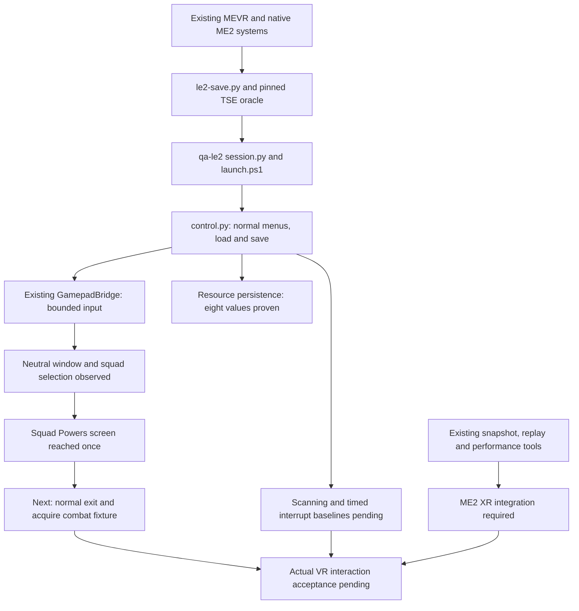

<!-- SPDX-License-Identifier: MIT -->
# LE2 testing tools: reuse audit and runtime observer history

Current audit: **2026-11-14**. Candidate `ad31adeb` adds the existing channel's
Back-only CharacterRecord adapter; its first native attempt stalled earlier at
BlackScreen after chapter loading, before any pulse. Resources/map matched,
but scene readiness failed and restoration verified. See the
[failed readiness attempt](le2-validation-evidence.md#powers-back-adapter-built-next-run-stopped-at-blackscreen-before-input).
The next `1902Z-checkpoint` run reached a reviewed Squad Selection screen, but
its sole A request received no controller polls/output. It closed and restored
without a resend. See the [undelivered selection evidence](le2-validation-evidence.md#chapter-scene-loaded-published-selection-received-no-controller-polls)
and the [revised acquisition priority](le2-fixture-acquisition.md#current-reload-acquisition-decision-2026-11-14).
The strongest earlier selection proof below is from candidate `7eee6b6f`.
We already have the ME2 save,
launch, protected-session, capture, control and scenario workflow. Native
eight-resource save/reload persistence is proven; an untouched chapter has loaded to
Squad Selection. One earlier run selected Miranda and Grunt and reached the
confirmation modal, but the next run did not reproduce that sequence. The `1821Z`
run selected Miranda and Grunt, showed the confirmation modal, then advanced to
the squad Powers screen after one confirmation pulse. Before confirmation, the
read-only observer resolved the external sequence owner and sampled its completion
flag as false. At that candidate the next screen was unsupported; no
true completion-flag sample or combat fixture was obtained.
Weapon observation has native samples. Reproducibility and progression beyond
the Powers screen remain unproven. The three gameplay
scenarios remain unvalidated. See the
[current evidence](le2-validation-evidence.md) and [workflow](../tools/qa-le2/README.md).
This update combines source inspection with the archived protected native run
`b9050968-61cb-4d26-9691-ee1ec0f84e80` and follow-up
`0ad9e033-a97d-4108-bbe7-e38a58812386`, followed by
`86d06e42-ad8a-466d-8770-76f46fe5397e`, then
`370f621d-8fa9-4b73-bd7c-c81935f64f0a`; all closed normally and restored all four
protected roots. The older observer design below is historical, not current readiness.

## Reuse map and current proof boundary



This is a dependency map, not a percentage-complete estimate. **Zero of the three
initial scenarios has end-to-end acceptance.** Native input/UI success is a
smaller, useful milestone. A diagnostic build without XR cannot prove stereo,
tracked-controller interaction, comfort or headset performance.

Audit findings:

1. Reuse is implemented: the input adapter shares the existing bridge's hook
   ownership and the existing run-bound control channel. The standalone hook
   draft was not integrated.
2. Publication is not delivery. The first run expired both pulses before an
   eligible poll. The correction starts the hold on the first eligible poll,
   bounded by a separate five-second activation wait; the next run produced
   positive output, neutral release and visible selection changes.
3. The `partyMember1/2` fields stayed zero during initial selection despite
   visible changes. The confirmation guard now observes indices 6/7 and labels
   Vixen/Grunt at the modal; do not extend those semantics to the earlier stage.
4. Run `1821Z` passed the modal and reached Powers. This does not establish
   why the previous run stalled. Do not admit every GUI screen merely to advance
   this fixture; inspect the actual Powers handler and its normal exit path.
5. Save/resource tools are usable now. Existing LE1 stereo, replay and scenario
   runners require ME2 producers/adapters; their presence is not ME2 readiness.

## Current script inventory and reuse decisions

| Need | Existing scripts / implementation | Current ME2 boundary and decision |
|---|---|---|
| Save inspection and constrained edits | [le2-save.py](../tools/le2-save.py): `info`, `diff`, `prepare`; [le1-save.py](../tools/le1-save.py) for LE1 | Use the existing LE2 v30/CRC adapter. Resource edit/load/save/reload is proven. Do not create another editor; weapon legality and coherent story recipes still need native evidence. LE1's format differs. |
| Independent save-format check | [build-tse-oracle.py](../tools/qa-le2/build-tse-oracle.py), [check-save-oracle.py](../tools/qa-le2/check-save-oracle.py) | Already uses pinned Trilogy Save Editor models/codec. Reuse for each new fixture; no new decoder or serializer. |
| Zero/insufficient/exact/surplus resources | [prepare-variants.py](../tools/qa-le2/prepare-variants.py), [variant usage](../tools/qa-le2/variant-usage.md) | Existing immutable recipe/batch machinery. Supply verified costs and native outcomes; do not write another generator. |
| Story and package investigation | [conversation-scan](../tools/conversation-scan/README.md), `--game LE2`; [story-review.py](../tools/qa-le2/story-review.py) | Reuse LegendaryExplorer-backed inspection and scoped before/after review. A plot label or parsed flag is not a validated progression recipe. |
| Backup, staging, process binding and restoration | [qa-le2/session.py](../tools/qa-le2/session.py): `prepare`, `bind-process`, `reset`; [fake-headset-session.ps1](../tools/fake-headset-session.ps1) is the LE1 workflow reference | ME2 lifecycle already freezes inputs, owns the shared lock and backs up four protected roots. Reuse it. The LE1 wrapper hardcodes ME1 saves/deployment/readiness; do not just change a process name. Whole-profile reset is not a merge engine for intervening sessions; use reviewed preservation recovery when needed. |
| Steam/EA launch | [qa-le2/launch.ps1](../tools/qa-le2/launch.ps1), [launch_support.py](../tools/qa-le2/launch_support.py); original [launch-game.ps1](../tools/launch-game.ps1) | ME2 already reuses Steam forwarding with verified game-2 selection and exact process binding. No new launcher needed. |
| Game-thread commands and normal load/save | [qa-le2/control.py](../tools/qa-le2/control.py), [control-attach.py](../tools/qa-le2/control-attach.py), [control guide](../tools/qa-le2/control.md); original [console.ps1](../tools/console.ps1) | Reuse the existing owned ME2 channel for new bounded capabilities. Normal menus/load/New Save work. The ordinary console implementation has an LE2 SDK route, but its general call/returned-string proof remains incomplete and the diagnostic host disables it. Do not introduce another request file or transport. |
| Verify a new in-game save | [save-evidence.py](../tools/qa-le2/save-evidence.py): `before`, `after` | Already binds reviewed UI, request, original inventory and actual added file. Reuse for combat/scanning saves, then independently decode and reload. |
| Desktop scene capture | [qa-le2/capture.py](../tools/qa-le2/capture.py); original [flicker-grab.py](../tools/flicker-grab.py) | Existing ME2 adapter adds exact run/PID binding, immutable receipts and an explicit desktop fallback to the older PrintWindow approach. Proven on menus/scenes. Do not create a third capture tool. |
| Observe or activate the owned game window | [focus-owned-session.ps1](../tools/qa-hubs/focus-owned-session.ps1), explicit `-Game LE2`; [usage](../tools/qa-le2/capture.md#observe-or-explicitly-activate-the-owned-window) | Reuses existing Win32 focus behavior and receipts. Observation is the default; `-Activate` is explicit. The first LE2 native attempt was refused by Windows with foreground HWND 0. PrintWindow now records foreground identity, so readable pixels are not mistaken for focus proof. |
| Stereo eyes and layer captures | [snapshot.ps1](../tools/snapshot.ps1), [TestLoop](../src/plugin/TestLoop.hpp) | Reuse the renderer callbacks and capture pipeline when the ME2 renderer is integrated. Current diagnostic host has no XR/Present producer. Desktop capture cannot replace both-eye proof. |
| Record, replay and synthetic controllers | [record.ps1](../tools/record.ps1), [replay.ps1](../tools/replay.ps1), [mevrrec.py](../tools/mevrrec.py), `make-*-recording.py`; [PoseRecording](../src/core/vr/PoseRecording.hpp) | Existing file format, decoder, timed sampler and generators are reusable. Live TestLoop playback currently depends on LE1 Halcyon XR frames. Add ME2 wiring/clock/provenance; do not create another recording format or generator. |
| Reproducible recorded routes | [qa-hubs/recorded_route.py](../tools/qa-hubs/recorded_route.py), [route.ps1](../tools/qa-hubs/route.ps1) | Reuse hash binding, neutral-tail and start-position checks. Current map/readiness rules are Citadel/LE1-specific; adapt those checks to verified ME2 state. |
| Native gamepad delivery | [GamepadBridge.cpp](../src/game/GamepadBridge.cpp), [GamepadMapping.cpp](../src/game/GamepadMapping.cpp); LE1 host [HalcyonBridge.cpp](../src/plugin/HalcyonBridge.cpp) | XInput DLL discovery, detours, deduplication, physical reads and mapping already exist. Extend the existing hook owner with an explicit diagnostic policy; do not land another hook registry. Details below. |
| Runtime state and scenario acceptance | [export-state.py](../tools/qa-le2/export-state.py), [scenario.py](../tools/qa-le2/scenario.py), three [scenario definitions](../tools/qa-le2/scenarios/) | Reuse current identity binding, resource normalization, assertions and native/VR gate separation. Extend verified fields for weapons/orbital state. No new scenario framework. |
| Archived recording analysis | [qa-le2/observe.py](../tools/qa-le2/observe.py) | Already imports `mevrrec.py`. It inspects archives, not the running game. Its truncation-reporting policy differs intentionally from route execution's rejection policy. |
| Performance and regression judges | [perf-probe.ps1](../tools/perf-probe.ps1), [perf-probe.py](../tools/perf-probe.py), [audit-report.py](../tools/audit-report.py), [scene_audit.py](../tools/scene_audit.py), [conversation-session.py](../tools/conversation-session.py) | Reuse formats, analysis and applicable rules. ME2 still needs actual render/body/input producers and comparable workloads. Missing measurements stay unmeasured; synthetic-headset pacing is not physical-headset acceptance. |
| Existing scenario runners | [conversation-from-save.ps1](../tools/conversation-from-save.ps1), [conversation-launch.ps1](../tools/conversation-launch.ps1), [conversation-audit.ps1](../tools/conversation-audit.ps1), [power-arena.ps1](../tools/power-arena.ps1), [mako-start.ps1](../tools/mako-start.ps1), [spot-survey.ps1](../tools/spot-survey.ps1) | Reuse orchestration and assertion patterns. Their current saves, maps, commands and native adapters target LE1; they are not already ME2 scenario drivers. |

The existing synthetic generators cover [walking](../tools/make-walk-recording.py),
[looking](../tools/make-look-recording.py), [menu interaction](../tools/make-menu-recording.py),
[wrist interaction](../tools/make-wrist-recording.py), [driving](../tools/make-drive-recording.py),
[galaxy picking](../tools/make-galaxy-pick-recording.py),
[rack motion](../tools/make-rack-recording.py) and [ADS](../tools/make-ads-recording.py).
These generate inputs; their names do not establish ME2 action semantics or success.

## Source-level duplication audit and consolidation decisions

Reviewed against local main `5cadc886`, including the ME2 additions themselves.
The inventory above names usable tools; this audit distinguishes actual shared
implementation from copied patterns and unresolved duplication. An existing
script's filename alone is not evidence that it can operate ME2.

| Area | Source finding | Decision and verification required |
|---|---|---|
| Save checksum | `le1-save.py::crc32_bzip2`, `le2-save.py::crc32_bzip2` and `qa-hubs/save_fixture.py::crc32` implement the same checksum independently | Candidate for one shared utility, preserving standalone imports, known vectors and real-save round trips for both games. Not consolidated at this checkpoint. |
| Save codec | LE1 `Save.from_bytes` parses compressed v50; LE2 `Save` parses uncompressed v30 with span-preserving scalar edits | Separate codecs are justified. Reuse the established LE2 adapter and pinned TSE oracle rather than building another editor. |
| Preparation receipt | `le2-save.py::main` and `qa-le2/prepare-variants.py::prepare` constructed the same receipt fields independently | Consolidated in `le2-save.py::make_receipt` after this audit. Both callers retain the existing schema; single/batch byte-equivalence tests cover no-op edits and float32 rounding. Frozen historical receipts are unchanged. |
| LE1 fixture location | `qa-hubs/save_fixture.py` has a partial compressed-header/location parser alongside the full LE1 parser | Consolidation candidate; preserve its bounded decompression checks and distinct Resume-profile handling. No LE2 need justifies another location parser. |
| Save dictionary | `save-dictionary.py` already imports the LE1 parser and conversation catalog; its proximity matching uses XY | Extend its reader with an LE2 adapter when needed. Include map and height/deck discrimination: XY alone cannot distinguish Normandy decks. Another dictionary implementation is unnecessary. |
| Backup and restoration | `qa-cafeteria/state.ps1` already hashes backups and archives changed files; `qa-le2/session.py` adds tree/timestamp checks, reparse rejection, ownership and retry records | There is overlapping infrastructure. Consolidate neutral primitives incrementally with recovery tests; retain the stronger protections. The older fake-headset wrapper deploys before backup and protects only ME1 saves/INIs, so replacing the ME2 lifecycle with it would lose coverage. |
| Window capture | `qa-le2/capture.py::bitmap` adapts the bitmap handling in `flicker-grab.py`; it does not import a common implementation | This is copied code, not completed deduplication. A future shared capture helper must retain run/PID binding, cleanup and immutable evidence. Keep the existing commands; do not add a third capture tool. |
| Recording checks | `qa-hubs/recorded_route.py` and `qa-le2/observe.py` overlap on header/time/finite validation; the latter already imports `mevrrec.py` | Share low-level validation when changing this code. Preserve policy differences: route execution rejects truncation; archive inspection reports discarded trailing bytes. Keep `.mevrrec` and existing generators. |
| Scenario reports | Hub schema/report requires LE1 walk/runtime artifacts; LE2 schema adds recipes, fixture identity and separate behavioral acceptance gates | Do not replace either with the other's narrower schema. Reuse applicable report/analysis functions through explicit artifact adapters, and leave missing measurements unmeasured. |
| Launch and request channel | LE1 launch hardcodes ME1 paths/readiness; `common.ps1::Write-MevrRequest` has shared replaceable filenames without run/PID/lease binding | Existing Steam forwarding is reused as an approach, not a call to `launch-game.ps1`. ME2 adds game selection and correlation. Continue through this one ME2 channel; general ConsoleCommand still requires native ownership/return proof. |

Direct reuse already present includes the shared `GamepadBridge` hook owner,
`qa-hubs/focus-owned-session.ps1`, `mevrrec.py` decoding, LegendaryExplorer-backed
conversation scanning and the pinned upstream TSE codec used by the oracle.
ME2 save collection, launching and export also share its existing session/control
modules. These are different claims from merely following an LE1 design.

The receipt extraction passed 14 save tests, 15 variant tests and the existing
cross-module workflow test. The integration run included the immutable private
chapter save; the worker also checked the archived Normandy save. These are
offline compatibility checks, not a new native save/load acceptance claim.

No broad infrastructure rewrite is required before the next native fixture.
Use `control.py`, `capture.py`, `export-state.py`, `save-evidence.py`, the existing
scenario drafts and resource variants. For longer routes, adapt the existing
recording sampler and clock rather than writing a new replay format. Menu and
galaxy pose generators target existing VR panel/hologram geometry; their output
is not automatically a valid native ME2 menu route. `perf-monitor.ps1` accepts
`-ProcessName MassEffect2`, but selects the first matching process and supplies
coarse process measurements, not owned-run frame timing or VR acceptance.

## Audit correction: share the input path (implemented)

The proposed standalone `Le2DiagnosticPad` XInput adapter would duplicate
`GamepadBridge.cpp`'s DLL list, slot registry, detours, target deduplication and
installation logic (`TryInstall`). **Do not land that draft.** It remains
uncommitted in its isolated worktree; that draft was never deployed.

The implemented integration seam is `GamepadBridge::Bridge`, immediately after its
original physical-pad read and before `Controllers::Latest`, head-yaw rotation
and support-grip mapping. Its explicitly opted-in diagnostic policy retains the
normal path and a single XInput owner. Caller provenance, recursion, complete
installation and cancellation/output serialization stay with that owner;
diagnostic hooks remain resident for the process lifetime.

The separate pure `DiagnosticPad::Source` component adds bounded run/sequence
admission, expiry, physical-input conflict and explicit neutral drain. Those are
not supplied by the existing controller snapshot: `Controllers::Latest` ages a
sample inactive after 250 ms but does not prove a neutral state reached the game.
Its checks are offline policy evidence; the latest run adds native delivery and
release evidence. It remains a narrow policy component, not another launcher,
replay system or hook.

For longer routes, reuse `PoseRecording::Load/Sample`, `.mevrrec`, the existing
generators and route checks. `TestLoop::OnFrameBegun` currently drives replay from
XR predicted-display time. Calling `replay.ps1` alone cannot drive the current
no-XR diagnostic host; it needs a bounded ME2 clock/input adapter. Distinguish
native gamepad baselines from actual VR-controller mapping acceptance.

The boundary is explicit in source: `Mod.cpp::MevrModTick` returns through
`le2_diagnostic::Tick` before ordinary console/gameplay/XInput installation;
`CMakeLists.txt::mevr_add_plugin` adds Halcyon TestLoop/PerfProbe host sources only
for LE1. The missing work is connecting reusable pieces, not replacing them.
Legacy `common.ps1` requests are shared and replaceable; keep ME2 actions on its
existing run/PID/lease-bound channel rather than copying those request writers.

## Next work using these tools

1. Resolve chapter readiness or acquire another natural fixture; `1848Z` stalled
   before selection. Then validate the implemented [Powers Back adapter](le2-powers-input.md)
   in the live screen reached by `1821Z`. Preserve unsupported-context rejection
   elsewhere; do not treat offline adapter checks as successful menu progression.
2. Reproduce normal squad selection and Powers exit, then acquire a safe combat
   save using existing New Save/collector tools. Add actual weapon/ammo
   observations before claiming reload behavior. Earlier stalled confirmation
   remains an unexplained reproducibility failure; the latest success does not
   prove that the neutral window, observer, or focus caused the difference.
3. Use the proven Normandy fixture and ordinary navigation to reach scanning;
   use the existing read-only orbital observer, resource export and save diff.
4. Acquire a natural pre-interrupt save and use the LE2 conversation scanner to
   bind window/branch assertions. Do not reset isolated plot flags as a shortcut.

No additional save editor, launcher, capture framework, scenario framework,
recording format or shared request channel is needed for these steps.

## Historical observer discovery

The remainder records the initial offline source audit at
`e4a0e485ee7a994a85615ab3021ecf310e0bff34`. At that checkpoint no LE2 observer
was implemented by this work. Later control/resource/load/save/reload proof and
the read-only orbital implementation supersede its implementation-status claims.
Its source boundaries and measurement requirements remain useful where unchanged.

## What the existing machinery actually provides

| System and source | Verified source behavior | LE2 reuse boundary |
|---|---|---|
| [CMakeLists.txt](../CMakeLists.txt), `mevr_add_plugin`, `MEVR_HALCYON_HOST_SOURCES` | `MEVR_GAME_LE1/LE2/LE3` is defined per target. Halcyon host sources, including TestLoop, PerfProbe, HalcyonBridge and GameThreadCalls, are appended only for `MEVR_HALCYON && game == LE1`. `MEVR_BUILD_LE2` defaults off. | Building an LE2 ASI does **not** provide the LE1 snapshot/record/performance subsystem. Pure helpers can be reused, but host integration must be built explicitly. |
| [plugin/Entry.cpp](../src/plugin/Entry.cpp), `GameEngineTickHook` | All games note the game-thread ID, call the original engine tick, run `host::Tick`, and report off-thread ProcessEvents. Halcyon tick/performance/queue draining is conditional on `MEVR_WITH_HALCYON`. | A post-engine-tick observation point exists without an XR frame. It is a candidate seam, not a verified LE2 state sampler. |
| [engine/GameAdapter.hpp](../src/engine/GameAdapter.hpp), `ReflectionLayout` and `ReflectionGlobalsForGame` | Both return `nullopt` outside LE1. [engine/Legacy.cpp](../src/engine/Legacy.cpp) uses LExSDKv2 for non-LE1 world/player/function access. | Existing `ue3::FieldRef` modules cannot be assumed to read LE2. A bounded LE2 SDK adapter or separately verified reflection layout is required. Do not transplant LE1 offsets. |
| [plugin/TestLoop.hpp](../src/plugin/TestLoop.hpp), [TestLoop.cpp](../src/plugin/TestLoop.cpp), `MetaJson`, `OnFrameBegun` | Captures XR swapchain images and layer composition, eye poses/FOVs, frame/display/Unix times, focus, controller sample, replay metadata and many mod/host diagnostics. GPU copies occur on Present, mapping later, PNG writing on a worker. | Useful image/capture design; no flat-game producer. The existing source producer is LE1-only. Format alone does not attest that any particular archived file came from LE1 or LE2. |
| [mod/Mod.cpp](../src/mod/Mod.cpp), `PublishStatus` | Returns unless host owns VR and `statusWanted`/`setStatus` are available. Publishes build date, mode, arm/aim/weapon pose status, support/holster/UI/movement diagnostics. TestLoop uses a recent cached status (under one second), not a synchronized post-action gameplay sample. | No usable native-baseline API with XR off. `mod.weapon.type/key/status` is not current loaded/spare ammo, reload commit count, plot outcome, probe/fuel or mineral state. |
| [game/Weapon.cpp](../src/game/Weapon.cpp), `TryStartup`, `Tick` | Weapon reflection and pose inspection are guarded for LE1; non-LE1 startup returns false and wanted tick reports `LE1 only`. [ConversationFlow.cpp](../src/game/ConversationFlow.cpp) and [GalaxyMap.cpp](../src/game/GalaxyMap.cpp) use LE1 reflection-era classes and semantics. | Those status names are not evidence of sequel implementations. Thermal clips, timed morality interrupts and mining require their own verified observers. LE1 conversation interruption/range is not the LE2 timed response window. |
| [core/vr/PoseRecording.hpp](../src/core/vr/PoseRecording.hpp), [PoseRecording.cpp](../src/core/vr/PoseRecording.cpp), [tools/mevrrec.py](../tools/mevrrec.py) | Engine-independent v1 binary recording: 32-byte header, 252-byte frames, predicted-display relative time, eye views, hand pose/button/axis samples. Reader/CSV exporter already exists. | Reuse decoder and format concepts offline. Header contains no game/PID/run/fixture/build/module hash. These are sampled controller states, not a timestamped trace of game-consumed actions. Truncated final frames can be dropped and must be reported. |
| [plugin/HalcyonBridge.cpp](../src/plugin/HalcyonBridge.cpp), `OnFrameBegun`, pad mapping | Input sync occurs before TestLoop. TestLoop records live sample or applies replay; calibration/menu capture and manual correction occur before published controller state. The game's returned pad is mapped/merged later with latches and context suppression. | Raw recorded trigger/button activity does not prove a reload/interrupt/probe action reached the game. Record raw source, effective mapping, consumed event and authoritative outcome as separate stages. |
| [game/GamepadBridge.cpp](../src/game/GamepadBridge.cpp), `Bridge` | For the non-Halcyon path, wraps real XInput, merges active VR state into pad 0, rotates movement, updates packets. XInput can be called on any thread. Only aggregate call/real-pad/controller-frame diagnostics exist. | A candidate place for a bounded raw/effective pad trace. It does not cover keyboard/mouse or establish native action dispatch. Do not run UE object reads or ProcessEvent in this hook. |
| [plugin/ProcessEventHook.cpp](../src/plugin/ProcessEventHook.cpp), [engine/ProcessEvent.cpp](../src/engine/ProcessEvent.cpp), [engine/CallFunction.cpp](../src/engine/CallFunction.cpp) | Host hook calls original before callback and records breadcrumbs/off-thread calls. Engine observer slots are single callbacks, alongside existing handlers. | Reuse ownership/lifetime conventions; do not replace the existing callback/observer or hook stack casually. A returned ProcessEvent is not necessarily a successful action. Action-specific pre/post state and normal return outcome still need verification. |
| [game/CallTrace.cpp](../src/game/CallTrace.cpp) | Diagnostic name-filtered trace, capped at 600 lines, with suppression counts; resolves names through our runtime reflection and installs engine observer callbacks. | Not a durable LE2 input/event recorder, and not a complete event count after suppression. LE2 reflection dependency remains. |
| [plugin/GameThreadCalls.cpp](../src/plugin/GameThreadCalls.cpp) | Bounded copied-parameter queue with alive/class checks; drained at engine tick in Halcyon builds. It depends on the reflection layout/globals that are currently LE1-only. | Reuse the design only after an LE2 ownership/lifetime adapter exists. Observer should read existing state, not call native operations to manufacture it. No UnrealScript on Present/worker/XInput threads. |
| [plugin/PerfProbe.cpp](../src/plugin/PerfProbe.cpp), `WriteCapture` | Halcyon/XR frame and engine-tick breakdown into frames/ticks/calls CSV plus probe JSON under `MEVR/perf`. | Not an LE2/native producer today; cannot infer real headset/transport performance from fake-headset measurements. |

## Paths that must not be used during the active ME1 run

[tools/common.ps1](../tools/common.ps1) sets one shared
`%LOCALAPPDATA%/MEVR` directory. `Write-MevrRequest` overwrites a named request
through a temporary file; it has no game ID, target PID, run ID or lease token.
`tools/snapshot.ps1`, `record.ps1`, `replay.ps1`, `console.ps1` use that helper.
`snapshot.ps1 -Spectator` also sends a console command that changes spectator
state. Changing a script's `GameRoot` does not isolate these requests.

| Shared path | Consumer and consequence |
|---|---|
| `snapshot.request`, `record.request`, `replay.request`, `perf.request`, `eyediff.request` | `TestLoop.cpp::PollRequests`; LE1 host can consume/delete them. Replay can replace poses and, with `inputs=1`, inputs. A request queued during another game may affect the next eligible LE1 run. |
| `console.request`, `console.result` | `game/ConsoleRequest.cpp::Tick`, called from `Mod.cpp` when developer channels are allowed. The generic console route is compiled for LE2/LE3 too; special `mevr ...` handlers are inside the LE1 guard. An LE2-intended file can be consumed by ME1, execute commands, and replace the result. |
| `testloop.status`, `snapshots/`, `recordings/`, `perf/` | Shared status/output, not a run-discovery protocol. TestLoop can prune old diagnostics under configured disk budgets. Timestamp or newest-file selection does not establish ownership. Archive explicit files before relying on them. |
| `%LOCALAPPDATA%/MELEVR/MELEVR_Log.txt` | Halcyon LE1 renderer log; not an LE2 observer feed. |

[core/DevChannels.hpp](../src/core/DevChannels.hpp) enables request channels by
default in development builds and disables them in monolithic builds, with a
`[Debug] requests` override. Do not change that setting or assume the live
session ignores requests. This package neither calls those scripts nor reads
their live outputs. Do not clear another session's requests or release its lock.

## Existing identity evidence and its limits

`Entry.cpp::SpiOnAttach` logs game name, project version, compiled commit and PID;
`ExeGate` checks the supported game version and address table. These are useful
startup diagnostics, not binary-content hashes or a proof of successful loading.
[core/Log.cpp](../src/core/Log.cpp) prefers
`Game/ME2/Binaries/Win64/Logs/LE2MEVR.log`, falling back to
`%LOCALAPPDATA%/MEVR/LE2MEVR.log`; the previous log is rotated. Log line clocks are
local time-of-day, so a complete capture needs a dated UTC/QPC anchor.

[plugin/ModLoader.cpp](../src/plugin/ModLoader.cpp) can load a shadow copy of
`LE2MEVR_mod.dll`; its generation log identifies the source path, while the loaded
module is the shadow DLL. Hashing only the current build output/source file is
insufficient after hot reload. The future observer must identify the actual
mapped host and mod generation and preserve dirty-build provenance. Monolithic
builds have a different identity shape and must be explicit.

`session.py` already binds exact game executable path/hash, PID and process start,
freezes scenario/recipe/prepared-save/receipt, and verifies restoration. The
auditor now requires the session binding. Extend those identities; do not create
another unrelated run ID. Legacy snapshots and recordings cannot acquire that
provenance merely by attaching their bytes to an LE2 run afterward.

## Safe offline archive inspector delivered here

[tools/qa-le2/observe.py](../tools/qa-le2/observe.py) accepts only explicitly named
archived snapshots/recordings and their expected SHA256. It never searches for
the newest capture, opens a process or writes a request. It rejects symlink/reparse
ancestors, known live MEVR/MELEVR folders and known game/profile trees. Outputs
must be new `.json` files in an existing private archive directory.

```text
python tools/qa-le2/observe.py snapshot PRIVATE_CAPTURE.json --sha256 CAPTURE_SHA256 --output NEW_INSPECTION.json
python tools/qa-le2/observe.py recording PRIVATE_RECORDING.mevrrec --sha256 RECORDING_SHA256 --output NEW_INSPECTION.json
python tools/qa-le2/test-observe.py
```

Snapshot inspection records hashes and header dimensions for explicit sibling
PNG files, missing images, eye metadata, producer errors and declared replay.
It does not decode/review pixels, authenticate the camera or prove stereo.
Recording inspection reuses `tools/mevrrec.py` after strict v1 layout, finite
sample and increasing-time checks, records decoder hash, frame counts/duration
and trailing partial bytes. Its flags do not prove physical hardware/human input.

Every result has `source: offline-recording-inspection`, unknown game attribution,
`acceptance: not-evaluated`, and false runtime/input eligibility. It deliberately
does not emit scenario `identity`, `state`, `inputPath` or `events`. It names the
missing LE2 gameplay/identity fields. It cannot satisfy `check-start` or the
runtime/input artifact gates. It may be retained as a reviewed diagnostic log.
Current tests are synthetic archive tests, not tests against a live capture.

## Next bounded package: LE2 native observer v1

Implement separately after the current game owner hands off. No runtime C++ or
shared ABI change is part of this audit. Proposed files are a small LE2 adapter
under `src/game/` and a pure record/queue/serializer under `src/core/`; final names
and host integration belong to P0/P1 owners. The package has five requirements:

1. **Read-only native operation, independent of XR.** Sample after the original
   engine tick, with valid local player/world and verified game-thread ownership.
   Publish `unavailable` plus a reason when a field/object is absent or the world
   is transitioning; never substitute zero or a value from the preparation recipe.
   Prove observation with no headset/OpenXR session. The current MEVR mod startup
   also attempts scene/input/gameplay hooks (`Mod.cpp::TryInstallScriptHooks`), so
   merely turning the headset off is not a proven inert observer configuration.
   Use an explicitly reviewed observation-only startup path or standalone bounded
   observer build; compare ordinary native behavior against an uninstrumented run.

2. **Session-scoped transport.** Session runner stages an opt-in configuration
   containing expected LE2 exe hash, PID/start after binding, run/case IDs, random
   nonce, expiry and explicit output directory. Proposed request location is
   `RUN/observer/LE2/<pid>-<start-token>/requests/<sequence>.json`; acknowledgment
   and outputs stay under that same private run. Bootstrap must itself be per-game
   and ownership checked, never the existing shared `console.request`. Reject
   another PID/game/run, stale sequence, mismatched nonce, expired lease, traversal
   and an old game's leftovers. Supported requests are only start/mark/stop
   observation, with no arbitrary console commands or mutation operation.

3. **Immutable identity and timeline.** Start header binds the existing scenario
   identity, executable path/hash/version, PID/start, actual host/mod module
   paths/hashes/generation, observer source/build and settings/DLC inventory.
   Each record carries run ID, sequence, world/load generation, game tick,
   monotonic QPC time/frequency and an anchored UTC time. XR display time is an
   optional additional clock, not the only clock. Track source and effective input
   clocks separately; document sampling latency and dropped events. Freeze record
   batches outside game-thread hot paths. Do not wait for workers or inspect UE
   objects during process teardown; preserve partial/truncated output as incomplete.

4. **Separate input from outcome.** Bound and preallocate an input/event queue;
   hooks on arbitrary threads copy primitive facts only. Game-thread sampling
   resolves verified identities/state. Tag source `native-keyboard-mouse`,
   `native-gamepad`, `vr-controller`, `replay`, or `diagnostic`; retain raw action,
   effective post-context mapping, game dispatch and outcome. Do not equate an
   XInput poll or repeated held button with a discrete gameplay commit. Native
   keyboard/mouse input is not covered by GamepadBridge and needs a verified game
   input seam or timestamped manual capture. Overflow/suppression/gaps keep
   event-count assertions pending. Existing observer slots need coordinated
   multiplexing or a non-conflicting seam, not silent replacement.

5. **Capture and honest normalization.** A flat-game video/screenshot producer
   must record process/window identity and capture time without activating XR.
   The current TestLoop cannot provide it. Keep capture frame/time links to game
   observations and manual annotations. Normalize only verified fields into
   scenario runtime/input artifacts, with raw hashes, producer versions, source
   field paths, availability and sampling clock. Require continuous selected-save
   and loading-scene evidence plus reviewer attribution. Save inspection remains
   `save-inspection`; capture inspection remains `offline-recording-inspection`.

## Initial semantic field contract

These are proposed normalized names from the scenario catalog, **not verified
LE2 memory offsets**. Pin native class/field/function identities and semantics
against the actual game build and ordinary before/after behavior before emitting
them. Keep optional or unresolved values absent with an explicit capability entry.

| Scope | Needed observations | Proof before implementation is accepted |
|---|---|---|
| Common start | `state.map`, world/load generation, selected career/slot evidence, local player identity/class, relevant resources/plot preconditions, current input/camera context | Correct normal Load Game entry, rendered scene and starting state; changing maps/loading clears stale references. No map-open/teleport as replacement. |
| Reload | Stable weapon instance/class, weapon switch epoch, `state.weapon.loaded`, `reserve`, native magazine capacity, float used-count and special-weapon rule; reload phase/early flag, request/accept/transfer/commit/cancel; firing/pickups during window; tutorial context; no-reserve refusal | Observe legal empty/partial reload, then interrupt/switch/no-reserve. Compare HUD/video and authoritative runtime counts. Count actual transfers, not input polls. Cancellation can perform an early reload; a cancelled animation alone must not imply zero ammo transfer. Save/load conversion and clamping require separate observations. |
| Dialogue interrupt | Conversation/entry identity, Paragon/Renegade prompt kind, window open/close timestamps, actual submitted response, accepted/missed result, branch continuation, input context before/after | Capture real prompt and timed accepted/missed/early input, then ordinary save/reload progression. No arbitrary plot index; verify conditions/package dependencies. LE1 flow/range diagnostics are not this window. |
| Planet scanning | Galaxy/system/planet identity, scanning UI mode, scan held/start/stop, probe launch request and actual single launch, `state.resources.probes`, `fuel`, mineral values, scan yield/cost, depleted/discovered/anomaly state | Same planet and configuration before/after ordinary scanning; zero/one/surplus probes, exact actual costs, no duplicate event, normal mission entry where relevant, save/reload comparison. Do not infer discovery from mineral gain alone. |

The [ammo source report](le2-ammo-fixture-source.md) traces `SFXSaveGame`
SaveWeapons/LoadWeapons: saved `ammo_total` maps to spare reserve,
`ammo_used_count` truncates a runtime float, and displayed loaded rounds derive
from integer conversion of magazine capacity minus used count. It also identifies
`Reloading.CancelReload` performing `DoReload` when `bEarlyReload` is set before
clearing timers. Record phase/early flag, capacity/class, float used count,
reserve, transfer events and input timestamps; do not encode "cancel means no
transfer" as a universal assertion. These are source-derived semantics; scoped
native proof is still pending. Native resource getters and interrupt/scanning
function candidates likewise need package/SDK research; this audit intentionally
invents no addresses or plot identifiers.

## Package acceptance and handoff

- Offline: serialization/duplicate-key/nonfinite/unknown-version refusal, bounded
  queue overflow and sequence gaps, process/run mismatch, expiry/path isolation,
  load generation reset, missing field handling, and clock correlation tests.
- Build: LE1 behavior unchanged; LE2 observer compiles with its explicit verified
  adapter and can remain disabled. Compilation is not native validation.
- First owned native experiment: one naturally acquired save, normal native load,
  read-only start record and scene, one legal reload, normal save/reload, protected
  restoration. Verify no XR initialization, synthesized input, mutation requests,
  off-thread script calls or unrelated hook behavior. Record process/module hashes.
- Repeat a timed interrupt and one-probe/zero-probe scan with their verified
  semantic adapters. Keep unimplemented cases pending; do not broaden this package
  into the full VR port. Only then integrate normalized records with
  `scenario.py audit --session RUN`. VR routing, both eyes, physical comfort,
  performance and campaign acceptance remain separate gates.

Until that native slot exists, usable work is source research, pure serializers,
fixture provenance and explicit archived-file inspection. Nothing in this plan
authorizes sending requests to the ongoing ME1 session.
